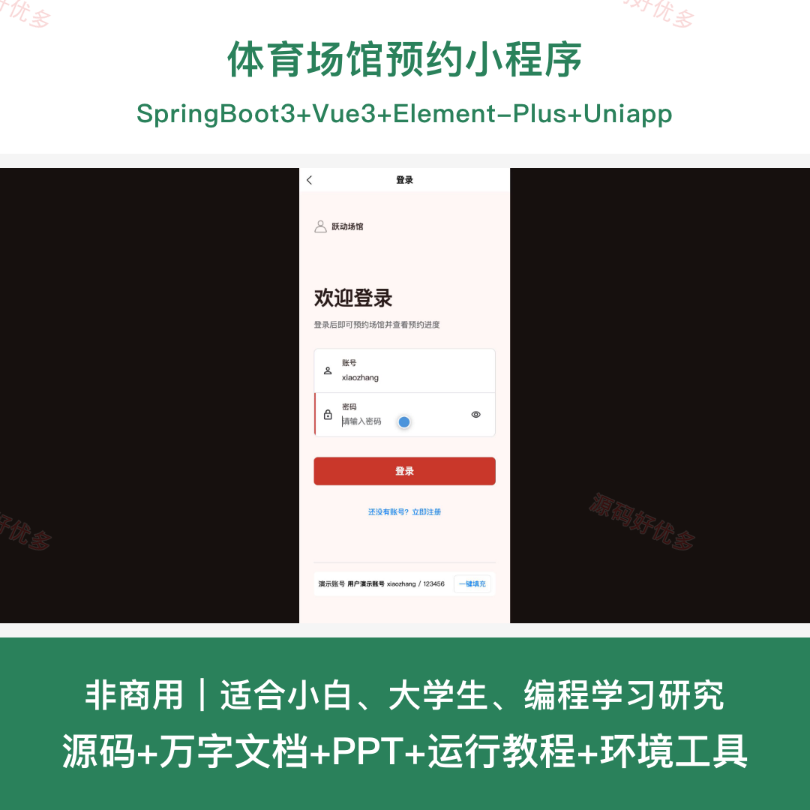
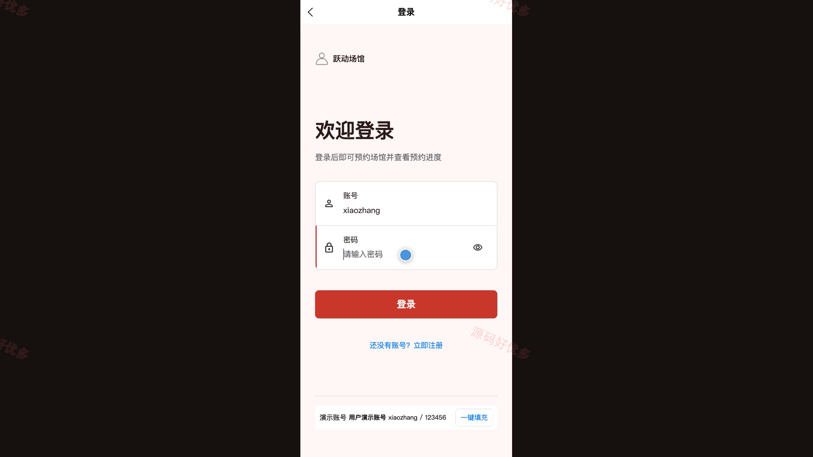
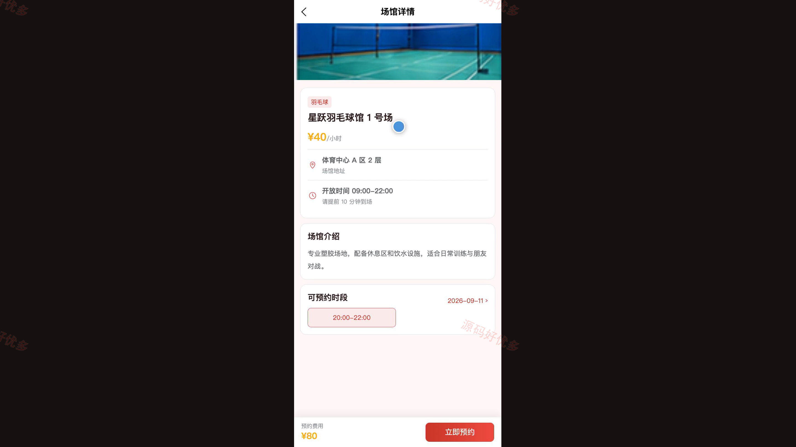
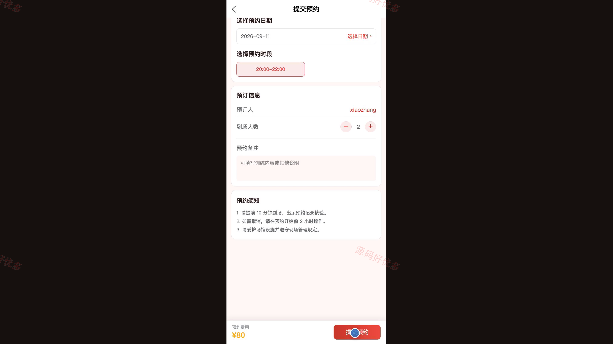
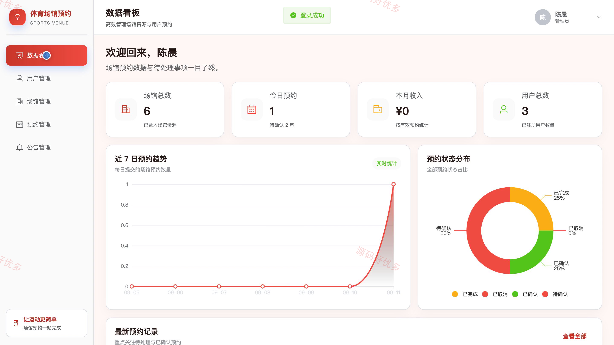
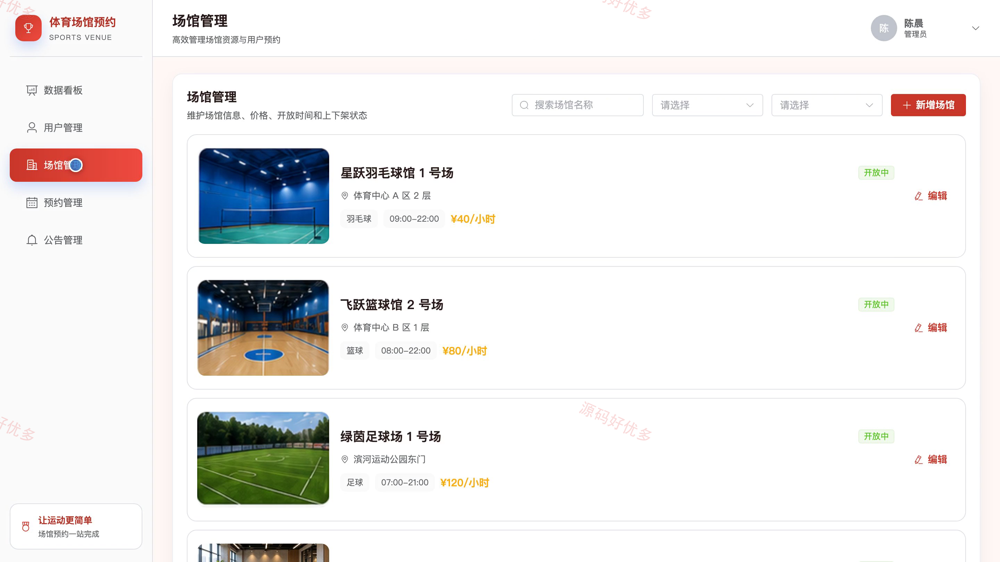
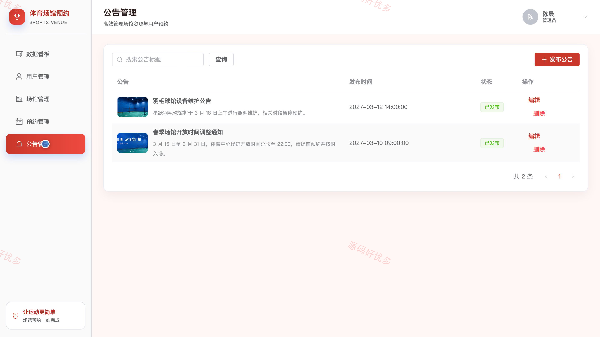

# bs117B
bs117B体育场馆预约系统
## 源码问题查看主页咨询

### 一、关键词
体育场馆预约、运动场地预订、球馆预约、场馆时段管理、健身场地预约

### 二、作品包含
源码+数据库+万字设计文档+PPT+全套环境和工具资源+本地部署教程

### 三、项目技术
前端技术： Html、Css、Js、Vue3.4、Element-Plus、uniapp
后端技术：Java、SpringBoot3.2.7

### 四、运行环境要求
开发工具：IDEA/eclipse + VSCODE + HBuilder X + 微信开发者工具

数据库：MySQL5.7+（共5张表）

数据库管理工具：Navicat10以上版本

环境配置软件： JDK17 + Maven3.6

前端Nodejs：20

浏览器：谷歌浏览器

### 五、项目介绍
项目编号：bs117B

本项目面向体育场馆日常预约与运营管理场景，用户可在微信小程序中查询场馆、查看开放时段并提交或取消预约；管理员可在电脑端维护场馆、处理预约、发布公告并查看运营数据。系统通过动态时段查询与冲突校验减少重复预约，结合预约状态流转和费用计算形成完整的场馆预约业务闭环。

角色：用户、管理员

用户功能：注册登录、首页浏览、场馆查询、场馆详情、提交预约、预约记录、取消预约、公告与个人资料。

管理员功能：管理员登录、数据看板、用户管理、场馆管理、预约管理、公告管理、个人中心。

### 六、运行截图

